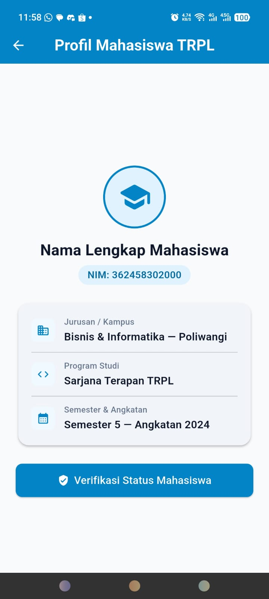
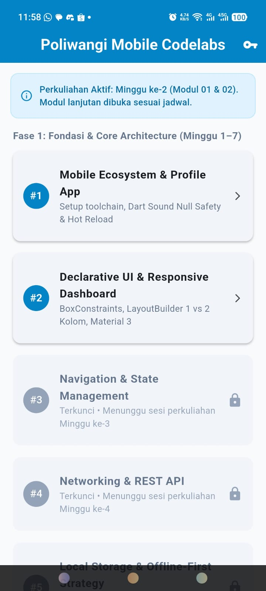

# Laporan Praktikum Modul 01: Mobile Ecosystem, Flutter Setup & Profile App

- **Nama**: Ira Agustin
- **NIM**: 362558302014
- **Kelas / Prodi**: 2E / Sarjana Terapan TRPL
- **Mata Kuliah**: Pemrograman Perangkat Bergerak (Semester 3)

---

## 1. Ringkasan Aktivitas
Minggu ini fokus kegiatan diarahkan pada persiapan awal pengembangan aplikasi mobile berbasis Flutter. Proses dimulai dengan mengunduh dan mengonfigurasi Flutter SDK, diikuti dengan instalasi Android Studio sebagai IDE utama. Selain itu, penyiapan environment variable serta kelengkapan dependensi Android SDK juga diselesaikan agar sistem dapat menjalankan perintah Flutter dengan baik.

Setelah tahap penyiapan selesai, langkah selanjutnya adalah mencoba menjalankan proyek awal Flutter secara langsung pada perangkat ponsel fisik. Pengaturan mode pengembang dan USB debugging diaktifkan di ponsel untuk menghubungkan perangkat dengan komputer. Pengujian berhasil dilakukan hingga aplikasi awal dapat melakukan proses build dan berjalan lancar di layar HP, menandakan bahwa lingkungan kerja telah siap digunakan untuk tahap pembuatan aplikasi berikutnya.

## 2. Bukti Tangkapan Layar (Running App)
[Sertakan minimal 2 screenshot bukti aplikasi profil berjalan di emulator atau HP fisik Anda]

## 3. Kendala yang Dihadapi & Solusinya
- **Kendala**: [Terjadi error cmdline-tools missing saat menjalankan flutter run]
- **Solusi**: [belum membuat flutter create jadi buat dulu]

## 4. Jawaban Pertanyaan Refleksi
1. **Pilihan Native vs Flutter**: [Pemilihan Flutter dibanding Native memberikan efisiensi pengembangan melalui single codebase, sehingga satu basis kode dapat digunakan untuk platform Android dan iOS sekaligus. Keunggulan fitur Hot Reload juga mempercepat proses iterasi serta menjaga konsistensi tampilan UI di berbagai perangkat dengan performa yang mendekati aplikasi native.]
2. **Prinsip UI = f(state)**: [Prinsip ini menyatakan bahwa tampilan antarmuka (UI) merupakan hasil turunan langsung dari kondisi (state) data aplikasi saat itu. Tampilan bersifat deklaratif, sehingga ketika terjadi perubahan state, Flutter akan menggambar ulang (rebuild) komponen UI secara otomatis untuk mencerminkan kondisi terbaru.]
3. **Pentingnya Conventional Commits**: [Standar Conventional Commits penting untuk menjaga struktur dan konsistensi riwayat perubahan pada repository Git. Format awalan seperti feat:, fix:, atau docs: memudahkan anggota tim memahami maksud dari setiap perubahan kode serta mendukung otomatisasi pembuatan changelog dan verifikasi versi aplikasi.]