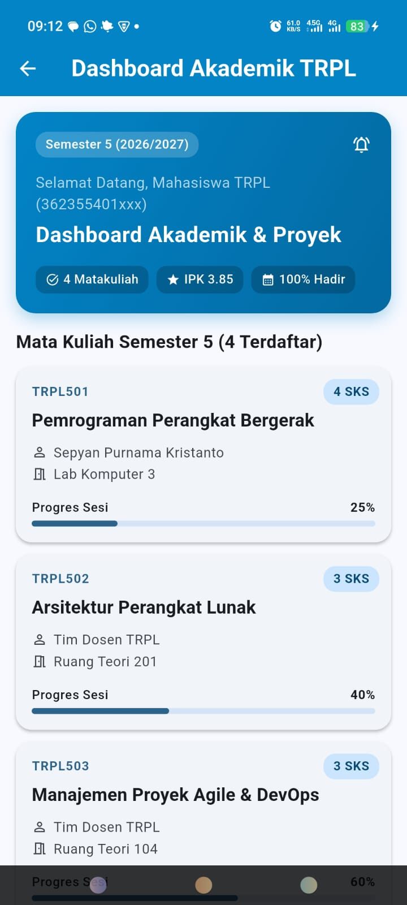
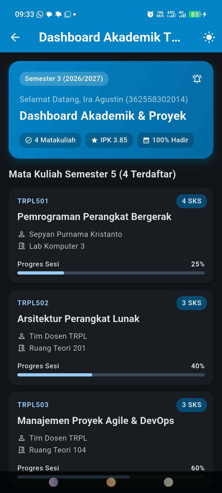
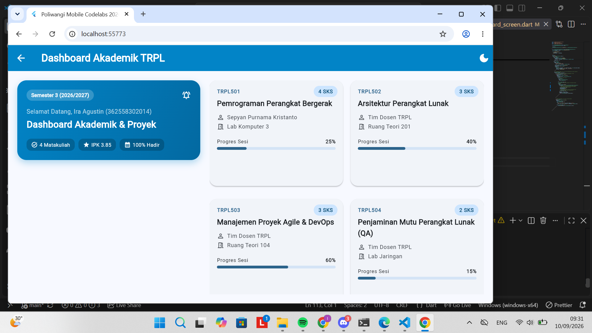

# Laporan Praktikum Modul 02: Declarative UI & Responsive Layout

- **Nama**: [ Ira Agustin]
- **NIM**: [362558302014]
- **Kelas / Prodi**: 2E Sarjana Terapan TRPL
- **Mata Kuliah**: Pemrograman Perangkat Bergerak (Semester 3)

---

## 1. Ringkasan Implementasi
[Perancangan dashboard responsif ini memanfaatkan `LayoutBuilder` untuk mendeteksi batasan lebar layar secara dinamis, di mana tata letak otomatis menyesuaikan menjadi satu kolom berbasis `ListView` pada perangkat mobile (di bawah 600dp) dan dua kolom menggunakan `GridView` pada layar yang lebih luas (600dp ke atas), sementara penerapan tema Material 3 menghadirkan konsistensi visual yang modern melalui palet warna harmonis dari `ColorScheme.fromSeed` serta pemanfaatan komponen UI bawaan seperti `Card` dan tipografi terstandarisasi.]

## 2. Bukti Tangkapan Layar (Running App)
| Mode Portrait (Light) | Mode Dark Theme | Mode Landscape / Tablet (2 Kolom) |
|---|---|---|
|  |  |  |

## 3. Kendala Layout yang Dihadapi & Solusinya
- **Kendala**: [Struktur kurung tutup yg di keyboard huruf 0 dan samping huruf p sempat tertukar posisinya saat menambahkan Expanded.]
- **Solusi**: [Merapikan kembali susunan kurung penutup pada kode widget Row.]

## 4. Jawaban Pertanyaan Refleksi
1. **Efisiensi Single-pass BoxConstraints**: [Membuat proses rendering layout jauh lebih cepat dan efisien karena batasan ukuran (BoxConstraints) diturunkan sekali dari induk ke anak (top-down), dan anak langsung mengembalikan ukuran pastinya ke atas (bottom-up) tanpa perlu melakukan perhitungan ulang (re-layout) secara berulang-ulang.]
2. **Kriteria Modularisasi Widget**: [Komponen perlu dimodularisasi (dipisah menjadi widget tersendiri) jika bagian tersebut memiliki struktur UI yang cukup kompleks, digunakan berulang kali pada halaman berbeda (reusable), atau untuk memecah baris kode yang terlalu panjang agar file utama lebih bersih, mudah dibaca, dan mempermudah debugging serta widget testing.]
3. **Manfaat M3 ThemeData Terpusat**: [Memastikan konsistensi gaya visual dan warna di seluruh halaman aplikasi secara otomatis, memudahkan pemeliharaan kode karena perubahan tema global (seperti warna utama atau seed color) cukup dilakukan di satu tempat tanpa harus mengubah satu per satu di setiap komponen.]