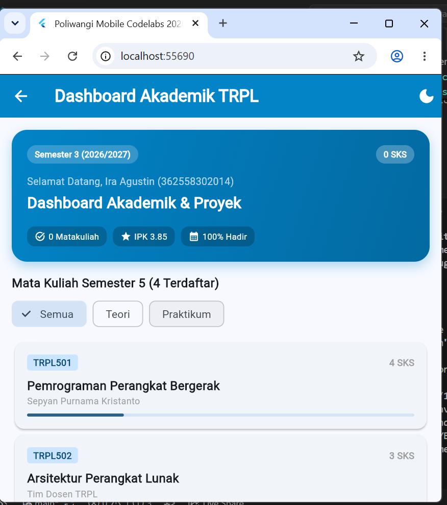
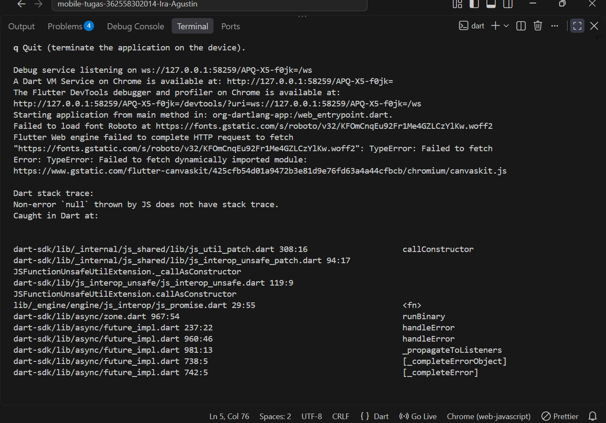
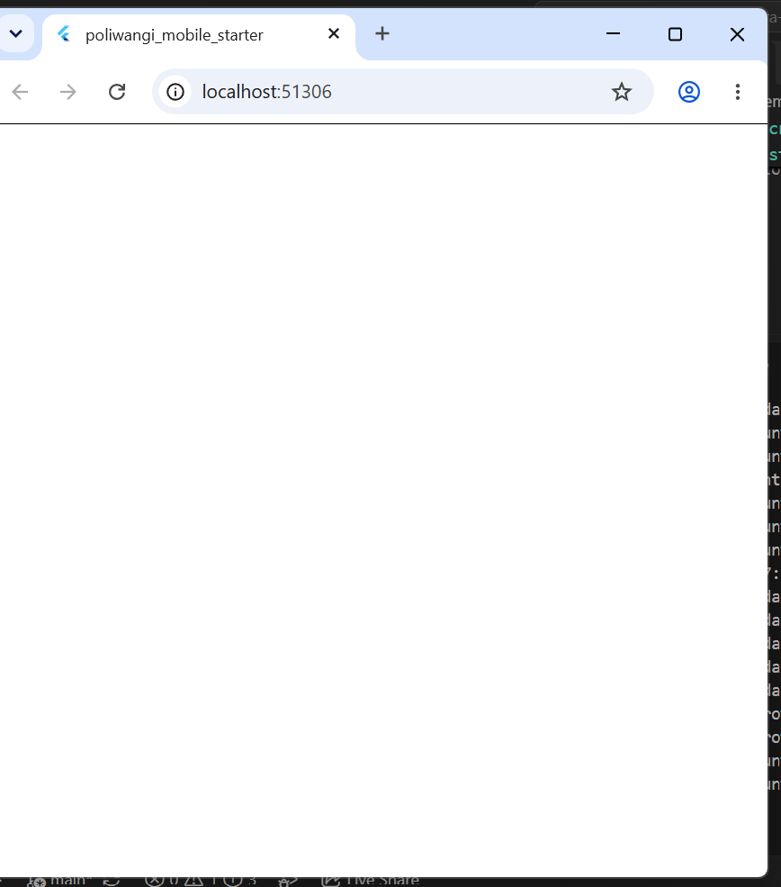

# Laporan Praktikum Modul 04: Future & REST API Dasar

* **Nama**: Ira Agustin
* **NIM**: 362558302014
* **Kelas / Prodi**: 2E Sarjana Terapan TRPL
* **Mata Kuliah**: Pemrograman Perangkat Bergerak (Semester 3)

---

## 1. Ringkasan Implementasi Fase A
Pada Fase A ini, portal pengumuman dibangun menggunakan pendekatan fundamental dengan package `http` dan `FutureBuilder` tanpa *library* state management tambahan. Implementasi berfokus pada:
- **Pengelolaan State Asinkron:** Variabel `_futurePengumuman` disimpan di dalam *State* dan diinisialisasi pada `initState()` untuk mencegah pemanggilan API berulang saat `build()` berjalan.
- **Empat Keadaan UI (4-States):** Antarmuka merender empat kondisi berbeda secara berurutan: memuat data (*loading*), gagal (*error*), data kosong (*empty*), dan daftar berhasil tampil (*success*).
- **Penanganan Error Terperinci:** Membedakan pesan kegagalan berdasarkan jenisnya, seperti `TimeoutException` untuk koneksi lambat dan `ClientException` untuk jaringan terputus, lengkap dengan tombol **Coba Lagi**.
- **Filter Lokal:** Penyaringan kategori pengumuman dieksekusi secara lokal di dalam method `build()` menggunakan fungsi `.where()`, sehingga pergantian kategori tidak perlu mengirim ulang *request* ke server.

## 2. Bukti Tangkapan Layar (Running App)

| Keadaan Berhasil | Keadaan Gagal (Error) | Keadaan Kosong (Empty) |  
|---|---|---|---|
|  |  |  |

## 3. Kendala yang Dihadapi & Solusinya
- **Kendala**: Terdapat masalah penempatan tanda kurung kurawal `}` penutup class `_AnnouncementListScreenState` yang tertutup terlalu cepat (tepat di bawah fungsi `dispose()`). Akibatnya, fungsi aksi asinkron dan fungsi *helper* UI pembangun antarmuka terlempar ke luar class dan menjadi *error*.
- **Solusi**: Memindahkan letak tanda kurung kurawal penutup kelas ke baris paling akhir file (setelah semua fungsi pembangun desain UI seperti `_buildBarisFilter()` dan `_buildDaftar()`) agar semua fungsi tersebut dikenali oleh *State* dan bisa mengakses variabel *context*.

## 4. Jawaban Pertanyaan Refleksi
1. **Di Fase A, penyaringan kategori dilakukan di dalam build() dengan where(). Di Fase B, penyaringan itu berpindah ke dalam repository. Menurut Anda, apa yang menjadi lebih mudah dan apa yang menjadi lebih sulit setelah perpindahan itu? Sebutkan satu hal untuk masing-masing.**
   Hal yang menjadi lebih mudah di Fase B adalah kode antarmuka (UI) layar menjadi jauh lebih bersih dan ringkas karena tidak lagi menyimpan logika penyaringan atau pengaturan state, melainkan bergantung sepenuhnya pada kontrak *Repository*. Namun, hal yang menjadi lebih sulit adalah pengaturan arsitektur proyek (arsitektur berlapis) menjadi lebih kompleks karena membutuhkan pembuatan berkas terpisah untuk *Repository*, *RemoteDataSource*, dan *Provider*, serta alur data yang lebih berlapis.

2. **Anda menulis `catch (e) { return []; }` agar aplikasi tidak pernah crash. Jelaskan mengapa keputusan itu justru membuat aplikasi lebih buruk, dan sebutkan apa yang seharusnya dilakukan.**
   Penggunaan blok kode *catch* tersebut menyembunyikan masalah yang sebenarnya (seperti kegagalan jaringan, Wi-Fi mati, atau server *down*) dengan memanipulasi pesan gagal seolah-olah menjadi "tidak ada data pengumuman". Hal ini membuat aplikasi lebih buruk karena pengguna tidak akan pernah mengetahui penyebab aplikasi tidak menampilkan apa-apa. Seharusnya, kita melempar nilai pesan kegagalan tersebut (`throw Exception`), agar kode pembangun antarmuka (`FutureBuilder` pada cabang `snapshot.hasError`) dapat memberikan *feedback* penyebab masalah dan menyediakan tombol tindakan agar pengguna bisa mencoba ulang permintaan (*Coba Lagi*).

3. **Pada Fase A, AnnouncementApi mengembalikan Announcement.getSampleAnnouncements() yang berupa list const. Di Fase B, SampleAnnouncementRepository menyalinnya lebih dulu dengan List.of. Menurut Anda, mengapa Fase A tidak membutuhkan penyalinan itu, sedangkan Fase B membutuhkannya? Kaitkan jawaban Anda dengan operasi apa yang dilakukan masing-masing kelas.**
   Pada Fase A, data daftar tiruan (*sample data*) hanya digunakan untuk pengujian tampilan murni (hanya di-baca / dirender), sehingga tidak pernah dimodifikasi atau ditambahkan elemen baru di dalamnya. Oleh karena itu, menggunakan *list const* sudah memadai. Sedangkan pada Fase B, terdapat implementasi kontrak pada *Repository* yang membutuhkan fungsi manipulasi atau modifikasi data pengumuman (misalnya `addAnnouncement`), sehingga daftar tiruan tersebut harus disalin terlebih dahulu menjadi tipe *List* dinamis menggunakan `List.of()`. Jika daftar tidak disalin menjadi dinamis, program akan mengeluarkan `UnsupportedError` pada saat proses modifikasi dilakukan.

4. **Riverpod 3 mencoba ulang provider yang gagal secara otomatis. Menurut Anda, mengapa perilaku itu dipilih sebagai bawaan, dan kapan justru merugikan? Berikan satu contoh situasi untuk masing-masing.**
   Percobaan ulang otomatis (dengan skema *exponential backoff*) tersebut dijadikan perilaku bawaan karena masalah gangguan stabilitas koneksi jaringan sementara (seperti perpindahan sinyal seluler ke Wi-Fi) sangat umum terjadi saat proses produksi (*production app*). Dengan ini, aplikasi tidak perlu terlalu cepat merepotkan pengguna dengan menekan tombol muat ulang secara manual. Namun, kondisi ini sangat merugikan pada fase pengujian otomatis (*widget testing*). Alih-alih pengujian langsung mendeteksi bahwa program berhasil menangkap parameter *error*, eksekusi pengujian justru akan menggantung (hang) hingga kehabisan waktu (*timeout*) sambil terus mencoba ulang permintaan.

5. **Andaikan endpoint pengumuman kampus hanya boleh dipanggil sekali per hari karena kuota. Apakah FutureBuilder di Fase A masih layak? Perubahan apa yang paling sedikit yang perlu Anda lakukan agar kuota itu tidak terlampaui?**
   Penggunaan standar `FutureBuilder` untuk menangani API berkuota ketat kurang ideal karena arsitekturnya rentan menyebabkan pemanggilan ulang fungsi *fetch API*, terutama jika nilai future tidak disimpan dengan aman di state atau pengguna terus melakukan gerakan penyegaran layar (*pull-to-refresh*). Agar kuota harian tidak terlampaui, perubahan paling ringkas yang bisa dilakukan adalah dengan menerapkan mekanisme *Caching*. Nilai balasan *HTTP Response* (pada fungsi `ambilPengumuman()`) yang sukses harus disimpan ke media penyimpanan lokal (seperti *SharedPreferences* atau *SQLite*) bersamaan dengan *timestamp* (waktu akses). Saat aplikasi dibuka ulang, program cukup mengecek apakah rentang waktu akses terakhir belum melewati batas satu hari; jika belum, program tidak akan melakukan *Request HTTP GET*, melainkan cukup mengembalikan data dari penyimpanan lokal (*cache*).