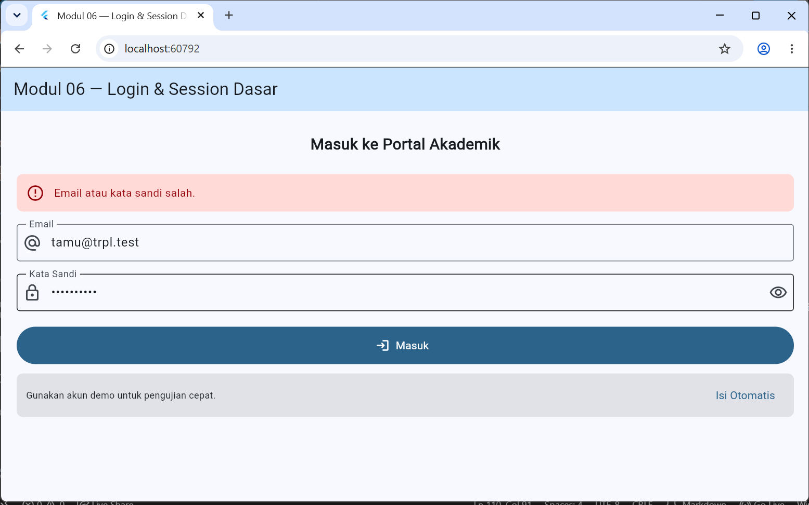
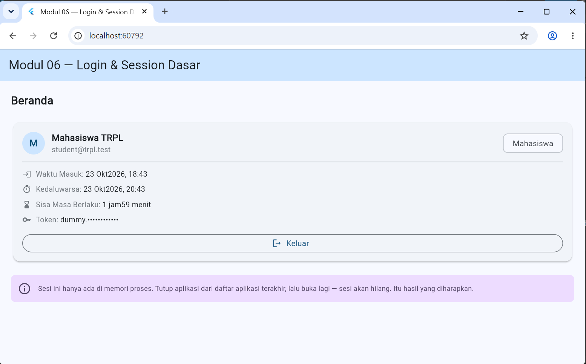
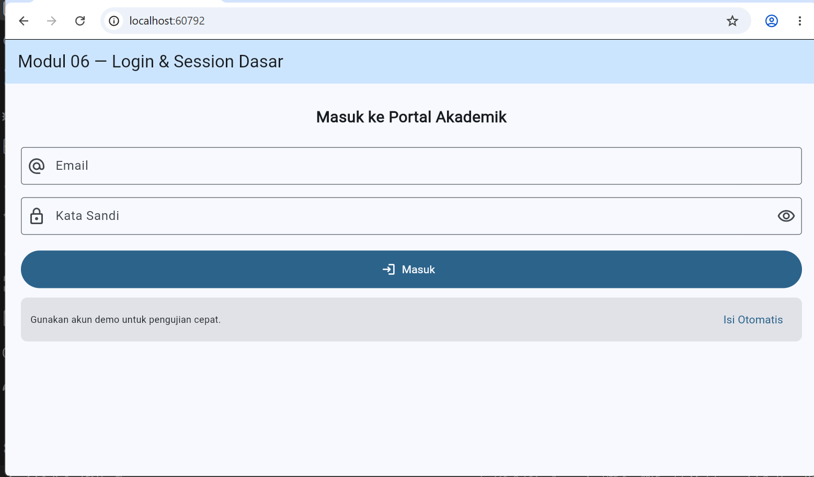

# Laporan Praktikum: Login & Session Dasar

- **Nama**: Ira Agustin
- **NIM**: [362558302014]
- **Kelas / Prodi**: 2E / Sarjana Terapan TRPL
- **Mata Kuliah**: Pemrograman Perangkat Bergerak
- **Modul**: 06 - Login & Session Dasar

---

## 1. Ringkasan Implementasi

Praktikum ini membangun alur login lengkap pada aplikasi Flutter dengan API tiruan lokal (`Future.delayed`), tanpa server nyata. Seluruh kredensial dan token adalah data dummy. Pekerjaan dibagi dua fase.

### Fase A: Fundamental (wajib)
Lokasi kode: `lib/modul_06/`

- **`Form` + `GlobalKey<FormState>`**: validasi email (tidak kosong, mengandung `@` dan `.`) dan kata sandi (tidak kosong, minimal 8 karakter). Validator mengembalikan `null` bila isi sah.
- **Mesin keadaan `StatusAuth`**: `memeriksa`, `keluar`, `memproses`, `masuk`, `gagal`. Keadaan `keluar` dipisahkan dari `gagal` agar pesan penolakan tidak tampil sebelum pengguna mencoba login.
- **Penjaga kirim ganda dua lapis**: `if (_status == StatusAuth.memproses) return;` di dalam `_kirim()` dan `onPressed: sibuk ? null : _kirim` pada tombol.
- **`mounted` setelah setiap `await`**: mencegah `setState()` pada layar yang sudah dibuang.
- **`AuthApi` tiruan** dengan empat jenis hasil:

  | Kredensial | Hasil |
  |---|---|
  | `student@trpl.test` / `belajar123` | Berhasil, token dummy |
  | Kata sandi lain | `AuthException` 401 |
  | `terkunci@trpl.test` | `AuthException` 423 (akun terkunci) |
  | `gangguan@trpl.test` | `AuthException` 503 (server bermasalah) |

- **`SesiMemori`**: sesi disimpan di memori proses, sehingga hilang saat aplikasi ditutup.
- **Token tersamar** di `KartuSesi` (hanya 6 karakter awal yang terlihat).

### Fase B: Pengayaan (dibaca dan dicoba, tidak wajib dikumpulkan)
Lokasi kode: `lib/pengayaan/modul_6/`

- **Kontrak `SesiRepository`** dengan tiga implementasi: `MemoriSesiRepository`, `PrefsSesiRepository` (bertahan tetapi token terbaca), dan `AmanSesiRepository` (memakai `flutter_secure_storage` lewat kontrak `PenyimpananAman`).
- **`SesiController` (`ChangeNotifier`)**: pemulihan sesi, masa berlaku, dan pembaruan sesi. Sesi yang sudah kedaluwarsa dihapus, bukan diperpanjang.
- **`GerbangSesi`**: satu tempat yang memilih layar berdasarkan status controller.
- **`PapanDiagnostikPenyimpanan`**: tombol "Intip isi penyimpanan" untuk membandingkan Prefs dan Aman.

## 2. Struktur Proyek

```
lib/
├── modul_06/                  # Fase A
│   ├── models/sesi_pengguna.dart
│   ├── services/auth_api.dart
│   ├── services/sesi_memori.dart
│   ├── widgets/field_kata_sandi.dart
│   ├── widgets/kartu_sesi.dart
│   ├── screens/login_screen.dart
│   └── modul_06_app.dart
└── pengayaan/modul_6/         # Fase B
    ├── storage/
    ├── repositories/
    ├── controllers/sesi_controller.dart
    ├── widgets/
    ├── screens/
    └── modul_06_pengayaan_app.dart
```

## 3. Bukti Tangkapan Layar (Running App)

| Login Gagal | Login Berhasil (Beranda) | Setelah Logout |
|---|---|---|
|  |  |  |

> Token pada tangkapan layar ditampilkan dalam bentuk tersamar. Tidak ada kredensial sungguhan yang dipakai.

## 4. Kendala yang Dihadapi & Solusinya

| Kendala | Penyebab | Solusi |
|---|---|---|
| `flutter pub add flutter_secure_storage` menampilkan pesan "Building with plugins requires symlink support" | Windows belum mengizinkan symlink | Mengaktifkan **Developer Mode** (`start ms-settings:developers`), lalu membuka ulang terminal dan menjalankan `flutter pub get` |
| Garis merah pada import `shared_preferences` | Paket belum terpasang | `flutter pub add shared_preferences` |
| `Repository.baca()` tidak dikenali | Huruf kapital salah dan fungsi ditulis di luar class | Diganti `repository.baca()` dan seluruh fungsi dipindah ke dalam class `SesiController` |
| `SesiPengguna.dariJson` / `keJson` tidak ditemukan | Nama method di model adalah `fromJson` / `toJson` | Nama method disesuaikan dengan model |
| Import `SesiPengguna`, `AuthApi`, dan repository merah | Path package salah (Fase B ada di `pengayaan/modul_6`, model di `modul_06`) | Import diperbaiki ke `package:modul_6/...` sesuai lokasi sebenarnya |
| `AmanSesiRepository` memakai `bacaMentah` yang tidak ada di `FlutterSecureStorage` | Repository seharusnya memakai kontrak `PenyimpananAman` | Repository menerima `PenyimpananAman` lewat konstruktor |
| Error di `papan_diagnostik_penyimpanan.dart` dan `modul_06_pengayaan_app.dart` | File hanya berisi potongan kode dari modul, tanpa class dan import | Ditulis lengkap sebagai `StatefulWidget` dan `StatefulWidget` aplikasi |
| Error di `test/widget_test.dart` | Tes counter bawaan Flutter tidak relevan dan memakai `await` di `main()` non-async | Diganti dengan tes login Modul 06 |

## 5. Jawaban Pertanyaan Refleksi

1. **Pertanyaan baru setelah sesi bertahan**: "Berapa lama sesi boleh bertahan?" Selama sesi hanya ada di memori, jawabannya otomatis: sampai aplikasi ditutup. Begitu sesi disimpan, masa berlakunya harus ditentukan sendiri, dan sesi yang sudah lewat batas waktu harus dibuang, bukan diperpanjang.

2. **Tombol kembali dan kesimpulan yang salah**: Tombol kembali hanya menutup layar, sedangkan proses aplikasi tetap hidup sehingga `SesiMemori` tetap ada. Orang bisa keliru menyimpulkan bahwa sesinya sudah tersimpan permanen, padahal sesi itu hanya bertahan selama proses hidup. Pembuktian yang benar adalah menutup aplikasi dari app switcher.

3. **Pesan "Email atau kata sandi salah"**: Pesan ini sedikit mengurangi kejelasan bagi pengguna, tetapi manfaat keamanannya lebih besar. Pesan yang menyebut "email tidak terdaftar" dapat dipakai penyerang untuk mengetahui akun mana yang valid (user enumeration). Kerugian kecil pada kenyamanan sepadan dengan perlindungan daftar pengguna.

4. **SharedPreferences dan kontrak `SesiRepository`**: `PrefsSesiRepository` memenuhi kontrak dengan benar, sehingga bukan "salah implementasi". Masalahnya adalah **pilihan yang tidak tepat**: SharedPreferences ditujukan untuk preferensi, tidak memberi jaminan secure storage, dan token lebih mudah diekstrak pada perangkat yang dikendalikan penyerang. Jadi "salah implementasi" dan "pilihan tidak tepat" bukan hal yang sama.

5. **Masih perlukah token disimpan di perangkat?** Ya, karena tanpa itu pengguna harus mengetik kata sandi setiap membuka aplikasi. Namun penyimpanan harus dibatasi: gunakan secure storage, beri masa berlaku pendek, hapus sesi yang kedaluwarsa, dan jangan menganggap penyimpanan aman sebagai pengaman mutlak. Keputusan akses yang sebenarnya tetap harus diperiksa server pada setiap permintaan.

## 6. Cara Menjalankan

```bash
flutter pub get
flutter analyze
flutter test
flutter run                          # mode normal
flutter run --dart-define=LAMBAT=true  # jeda 2 detik untuk mengamati "memproses"
```

Untuk menjalankan Fase A, set `home: const Modul06App()` di `lib/main.dart`. Untuk Fase B, gunakan `Modul06PengayaanApp()`.

---

**Link GitHub**: https://github.com/iraagustin889/project-tiga-36255832014-Ira_Agustin.git